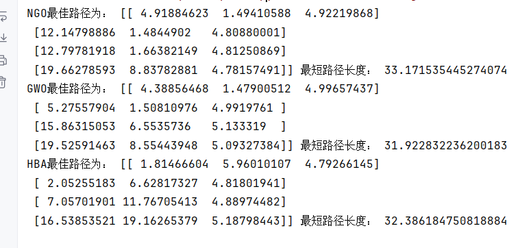
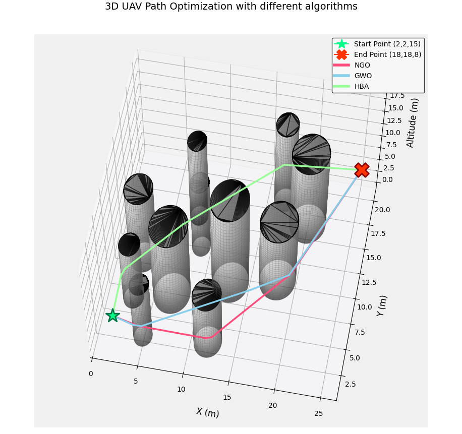
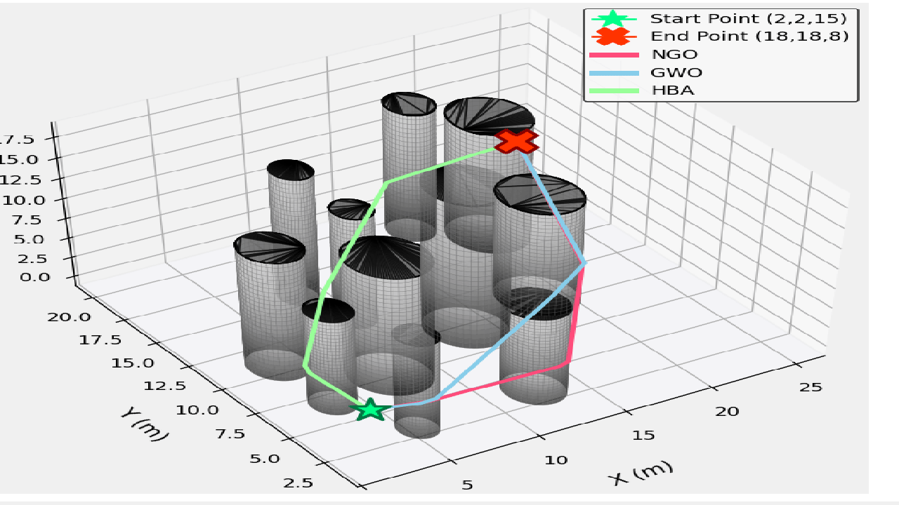
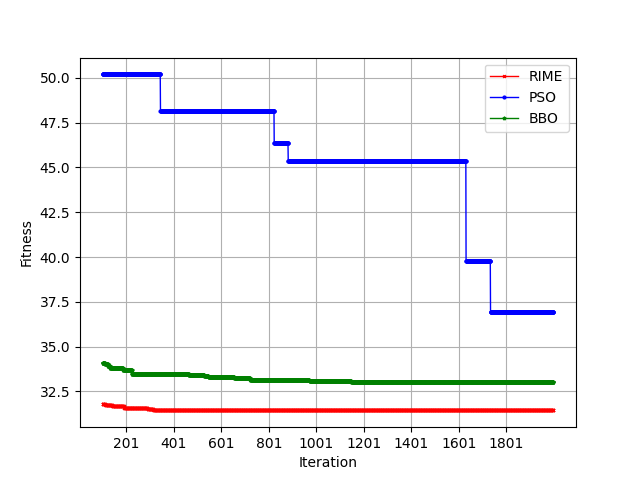
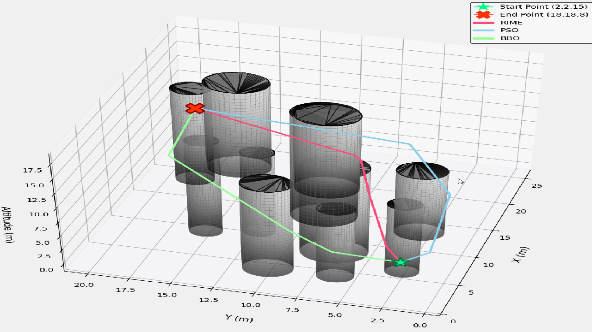

# Drone 3D Path Planning, over 170 optimization algorithms can be switched at will, map can be changed at will, detailed comparative experiments.

This issue code utilizes the powerful Python library, mealpy, to implement 3D path planning for unmanned aerial vehicles (UAVs). It allows for a convenient comparison of 215 algorithms, ensuring your paper is not lacking in strength!
The mealpy library contains over 170 intelligent optimization algorithms, including some original and improved ones. For a detailed introduction to the mealpy library, please visit this link: https://mealpy.readthedocs.io/en/latest/ 
The functionality implemented in this issue code includes:
① The ability to freely change the 3D UAV model map, adding obstacles at will and changing the starting point position at will;
② All 170 algorithms from the mealpy library can be applied to this path planning model;
③ A comparative plot of the best short-path iteration curves among different algorithms has been drawn;
④ A comparative plot of the UAV flight trajectory under 3D models has been drawn.
After mastering this issue code, refer to some papers and use the improved intelligent algorithms for robot path planning, highlighting the advantages of the improved intelligent algorithms!
First group experiment:
Using Northern Eagle (NGO), Grey Wolf Algorithm (GWO), and Honey Badger Algorithm (HBA) for comparison, the convergence curve is as follows. After 2000 iterations, the Grey Wolf Algorithm found the shortest path.
Automatically print out the results:
\n        \n  
3D Path Planning Diagram:
\n        \n  
Upon first glance, one might think that all the paths are navigating through obstacles, but in reality, as seen in the animation below, each drone's path perfectly avoids any obstacles!
\n        \n  
Group 2 experiment:
Due to the simplicity of the mealpy library's switching algorithm, you can switch several new algorithms in just a few seconds! With so many algorithms, you can switch at will!
# To facilitate algorithm usage, I have included some algorithm names here. For detailed information on each algorithm, please refer to the following documentation: https://mealpy.readthedocs.io/en/latest/# (BBO, BBOA, BMO, EOA, IWO, SBO, SMA, SOA, SOS, TPO, TSA, VCS, WHO)(CRO, DE, EP, ES, FPA, GA, MA)(BRO, BSO, CA, CHIO, FBIO, GSKA, HBO, HCO, ICA, LCO, QSA, SARO, SPBO, SSDO, TLO, TOA, WarSO)# (AOA, CEM, CGO, CircleSA, GBO, HC, INFO, PSS, RUN, SCA, SHIO)(ArchOA, ASO, CDO, EFO, EO, EVO, FLA, HGSO, MVO, NRO, RIME, SA, TWO, WDO)#  (ABC, ACOR, AGTO, ALO, AO, ARO, AVOA, BA, BeesA, BES, BFO, BSA, COA, CoatiOA, CSA, CSO, DMOA, DO, EHO, ESOA, #   FA, FFA, FFO, FOA, FOX, GJO, GOA, GTO, GWO, HBA, HGS, HHO, JA, MFO, MGO, MPA, MRFO, MSA, NGO, NMRA, OOA, PFA,#   POA, PSO, SCSO, SeaHO, ServalOA, SFO, SHO, SLO, SRSR, SSA, SSO, SSpiderA, SSpiderO, STO, TDO, TSO, WaOA, WOA, ZOA)#  AEO, GCO, WCA, HS\nLet's compare three more! We will use the Frost Icing Optimization Algorithm (RIME), Particle Swarm Optimization (PSO), and Biogeography-Based Optimization Algorithm (BBO) for comparison. The convergence curve is as follows: after 2000 iterations, the Frost Icing Algorithm found the shortest path.
\n        \n      \n        \n  
Partial code display
from matplotlib.colors import LightSource\nimport numpy as np\nimport random\nimport math\nfrom src.core.uav_setup import UAV_SetUp\nimport matplotlib.pyplot as plt\nfrom src.core.obj_fun import ObjFun\nfrom mealpy import GWO,HBA,BMO,NGO,IWO,TPO\n'''mealpy This package must be included. 2.5.3Version! ! !  '''\n'''Want to change the map, change the starting point location, in""uav_setup.py" Modify'''\n#  To facilitate algorithm invocation, I have included some algorithm names here. For detailed information on each algorithm, please refer to the guide. https://mealpy.readthedocs.io/en/latest/\n#  (BBO, BBOA, BMO, EOA, IWO, SBO, SMA, SOA, SOS, TPO, TSA, VCS, WHO)(CRO, DE, EP, ES, FPA, GA, MA)(BRO, BSO, CA, CHIO, FBIO, GSKA, HBO, HCO, ICA, LCO, QSA, SARO, SPBO, SSDO, TLO, TOA, WarSO)\n# (AOA, CEM, CGO, CircleSA, GBO, HC, INFO, PSS, RUN, SCA, SHIO)(ArchOA, ASO, CDO, EFO, EO, EVO, FLA, HGSO, MVO, NRO, RIME, SA, TWO, WDO)\n#  (ABC, ACOR, AGTO, ALO, AO, ARO, AVOA, BA, BeesA, BES, BFO, BSA, COA, CoatiOA, CSA, CSO, DMOA, DO, EHO, ESOA, \n#   FA, FFA, FFO, FOA, FOX, GJO, GOA, GTO, GWO, HBA, HGS, HHO, JA, MFO, MGO, MPA, MRFO, MSA, NGO, NMRA, OOA, PFA,\n#   POA, PSO, SCSO, SeaHO, ServalOA, SFO, SHO, SLO, SRSR, SSA, SSO, SSpiderA, SSpiderO, STO, TDO, TSO, WaOA, WOA, ZOA)\n#  AEO, GCO, WCA, HS\n# ... Other imports remain unchanged. ...\ndef set_seed(seed=None):\n    if seed is None:\n        seed = random.randint(0, 100000)\n    np.random.seed(seed)\n    random.seed(seed)\n    return seed\ndef configure_3d_axis(ax):\n    '''Configure 3D coordinate axis parameters'''\n    ax.grid(True, linestyle=':', alpha=0.6, color='slategray')\n    ax.xaxis.pane.set_facecolor('white')\n    ax.yaxis.pane.set_facecolor('whitesmoke')\n    ax.zaxis.pane.set_facecolor('ghostwhite')\n    ax.set_xlabel('X (m)', fontsize=12, labelpad=12)\n    ax.set_ylabel('Y (m)', fontsize=12, labelpad=12)\n    ax.set_zlabel('Altitude (m)', fontsize=12, labelpad=12)\ndef draw_obstacles_3d(ax, obstacles):\n    """Enhanced 3D Obstacle Drawing"""\n    ls = LightSource(azdeg=100, altdeg=45)\n    for x, y, h, r in obstacles:\n        # Column surface\n        theta = np.linspace(0, 2 * np.pi, 80)\n        z = np.linspace(0, h, 30)\n        theta, z = np.meshgrid(theta, z)\n        x_cyl = x + r * np.cos(theta)\n        y_cyl = y + r * np.sin(theta)\n        # Add material effects\n        shaded = ls.shade(z, cmap=plt.cm.Greys_r, vert_exag=0.2)\n        ax.plot_surface(x_cyl, y_cyl, z, facecolors=shaded,\n                        alpha=0.6, edgecolor='dimgray', linewidth=0.2)\n        # Top platform\n        theta = np.linspace(0, 2 * np.pi, 100)\n        x_top = x + r * np.cos(theta)\n        y_top = y + r * np.sin(theta)\n        ax.plot_trisurf(x_top, y_top, np.full_like(x_top, h),\n                        color='gray', alpha=0.6, edgecolor='k')\n  
The library version requirements are as follows: Python is recommended to use version 3.9 and above.
numpy~=2.0.2\ntqdm~=4.67.1\nmatplotlib~=3.9.4\nmealpy~=2.5.3\nscipy~=1.13.1\n  

## Images

<!-- PAYMENT_BLOCK -->

## Get this dataset

- Payment link (Stripe): [Buy now](https://buy.stripe.com/3cs8yP7sY87d0vu9AB)
- Payment QR code: 

<!-- /PAYMENT_BLOCK -->
